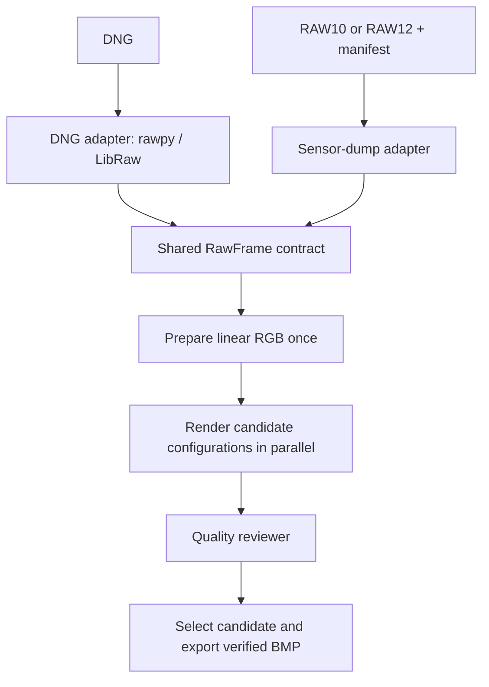

# Multi-agent ISP workflow

A runnable Python reference framework for converting DNG and bare RAW10/RAW12 sensor captures into 24-bit BMP images. Six local agent roles coordinate decoding, deterministic image processing, parallel candidate rendering, quality review, and verified export.

The agents are Python role classes. They run without an LLM service, API key, or external agent framework. Their boundaries provide extension points for a future model-backed tuning policy.



## Install

Use CPython 3.10 or newer with a platform supported by NumPy and Pillow. DNG support additionally needs a compatible rawpy wheel or a working rawpy/LibRaw build.

```sh
python -m venv .venv
# Activate .venv using your shell's activation command.
python -m pip install '.[dng,dev]'
```

For sensor dumps alone, `python -m pip install .` installs the core dependencies. The `dev` extra supplies pytest and tifffile; tifffile is used only to generate synthetic DNG fixtures. The test configuration places `src` on pytest's import path, so tests exercise workspace source changes directly. Reinstall with the command above before checking those changes through the installed CLI. Regular installation also avoids editable-install path encoding issues on some Windows workspaces containing Unicode characters.

## Run a conversion

```sh
# DNG: use embedded capture metadata through the LibRaw backend.
python -m isp_workflow capture.dng --output-dir runs/dng

# Bare sensor data: supply the exact byte layout and sensor calibration.
python -m isp_workflow capture.raw --manifest capture.json --output-dir runs/raw

# Compare explicit render candidates and retain the prepared float image.
python -m isp_workflow capture.raw --manifest capture.json --output-dir runs/tuned --config examples/render_config.json --workers 2 --save-intermediates
```

The installed `isp-workflow` command accepts the same arguments. Choose a fresh output directory for each run; nonempty directories are rejected to preserve prior results.

## Generate and try synthetic inputs

```sh
python examples/generate_demo.py --output demo-data --dng
python -m isp_workflow demo-data/frame_raw10.raw --manifest demo-data/frame_raw10.json --output-dir runs/demo10
python -m isp_workflow demo-data/frame_raw12.raw --manifest demo-data/frame_raw12.json --output-dir runs/demo12
python -m isp_workflow demo-data/frame.dng --output-dir runs/demo-dng
python -m pytest
```

The generator creates deterministic color patches and a gray ramp at 256 × 192 pixels. Its calibration values describe an invented camera with linear sRGB channels. Replace these values with measured calibration for real captures.

## Agents and handoffs

| Role | Work | Handoff |
| --- | --- | --- |
| Coordinator | Execute dependencies, cache prepared data, manage worker count | Run result and log |
| Intake | Route the input, decode samples, validate capture metadata | `RawFrame` |
| ISP processor | Prepare linear RGB and render immutable candidate settings | RGB arrays and previews |
| Tuning | Propose a bounded set of render configurations | Candidate configurations |
| Quality reviewer | Measure clipping and image statistics; select a candidate | Quality report |
| Export | Encode BMP and reopen it to verify pixel consistency | `output.bmp` |

Different candidates share the same prepared frame and render concurrently. Candidate settings control exposure compensation, contrast, denoising, and sharpening. Packing, Bayer order, black levels, and calibration remain validated capture facts.

The default policy compares three presets in one bounded round. A custom policy can return between one and twelve validated configurations. For example:

```python
from pathlib import Path
from isp_workflow.models import RenderConfig
from isp_workflow.workflow import Coordinator

class MyTuningPolicy:
    def propose(self, frame, linear):
        # Inspect frame metadata or the read-only prepared image here.
        return [
            RenderConfig(name="baseline"),
            RenderConfig(name="gentle_denoise", denoise=0.2),
        ]

result = Coordinator(tuning_policy=MyTuningPolicy()).run(
    Path("capture.raw"),
    Path("runs/custom"),
    manifest_path=Path("capture.json"),
    workers=2,
)
print(result.output_path)
```

Candidate selection minimizes the fraction of pixels reaching code 255 in any channel among passing candidates, with configuration order breaking ties. A dark or blurred image can still pass this check; use reference captures and human review for tuning decisions.

## Sensor-dump manifest

A manifest describes one complete frame. Paths in `sensor_profile` are relative to the manifest. Capture values override matching profile fields.

```json
{
  "layout": "mipi_raw10",
  "width": 1920,
  "height": 1080,
  "row_stride_bytes": 2400,
  "data_offset_bytes": 0,
  "cfa_pattern_at_frame_origin": "RGGB",
  "black_level": 64,
  "white_level": 1023,
  "white_balance": [2.0, 1.0, 1.5],
  "sensor_profile": "sensor_A.json"
}
```

The numbers above are illustrative. White level may be below the nominal maximum code. A profile can supply `camera_to_linear_srgb`, an optional 3 × 3 matrix whose convention is `output_rgb = camera_rgb @ matrix.T`. Without this calibration the workflow identifies the result as an approximate-color preview.

| Field | Meaning |
| --- | --- |
| `layout` | `mipi_raw10`, `mipi_raw12`, or `unpacked16` |
| `width`, `height` | Stored frame dimensions in pixels |
| `row_stride_bytes` | Total bytes per stored row, including padding |
| `data_offset_bytes` | Bytes before the first row; defaults to zero |
| `bit_depth` | Required for `unpacked16`: 10 or 12 |
| `byte_order`, `bit_alignment` | Required for `unpacked16`: `little`/`big`, `lsb`/`msb` |
| `cfa_pattern_at_frame_origin` | `RGGB`, `BGGR`, `GRBG`, or `GBRG` |
| `black_level`, `white_level` | Scalar or four values in CFA-site row-major order |
| `white_balance` | Three positive RGB gains |
| `camera_to_linear_srgb` | Optional measured camera RGB → linear sRGB transform |
| `crop` | Optional `[x, y, width, height]`, applied after demosaicing |
| `orientation` | Optional EXIF orientation 1–8, applied after crop |
| `sensor_profile` | Optional JSON calibration/layout file |

MIPI RAW10 stores four samples in five bytes; MIPI RAW12 stores two in three bytes. `unpacked16` handles samples expanded into 16-bit words with explicitly declared byte order and valid-bit alignment. These layouts operate on image payloads. CSI-2 packet captures, vendor-specific compression, multiple frames per file, and ambiguous layouts need their own adapters.

## Processing behavior and limits

For sensor dumps, the reference ISP subtracts black levels, normalizes by white levels, applies white balance, performs bilinear Bayer demosaicing, and applies the camera color transform. Cropping and display orientation follow demosaicing to preserve Bayer phase. The prepared image uses floating-point linear sRGB. Rendering applies exposure, contrast, a simple box-filter denoise blend, unsharp masking, clipping, the sRGB transfer function, and final 8-bit quantization.

For DNG, rawpy/LibRaw performs the RAW front end: normalization, white balance, demosaicing when appropriate, and color conversion to **16-bit linear sRGB**. The adapter requests linear gamma and disables automatic brightness adjustment. The returned frame records those completed stages, and shared processing skips their repetition. Common render candidates operate after that backend conversion. This path handles DNG variants supported by the installed LibRaw build; it does not claim full DNG-spec compliance, identical output to Adobe software, or support for every Linear DNG, compression method, opcode, and profile feature. Backend conversion to 16-bit RGB may clip negative values and highlight headroom before shared rendering.

The current skeleton does not implement lens-shading calibration, bad-pixel correction, advanced demosaicing, sensor noise models, calibrated color-chart evaluation, or learned tuning. Those are natural processor and reviewer extension points. The included quality measurements are heuristics: they can reveal clipping and gross failures, but cannot establish color accuracy or perceptual superiority without reference captures and human review.

## Run artifacts

Each successful run records:

```text
output.bmp             Selected 8-bit-per-channel RGB image
metadata.json          Resolved input description and provenance
isp_config.json        Selected rendering configuration
quality_report.json    Candidate measurements, selection, and warnings
agent_log.json         Agent handoffs and execution events
previews/              Candidate PNG previews
intermediate.npy       Prepared float image, when requested
```

BMP verification reopens the encoded file and checks its dimensions and RGB pixels. Source checksums and recorded configuration support reproducibility. The test suite exercises packing, calibration, demosaicing, orientation, rendering, validation, concurrent output reservation, and workflow failures; the CI workflow also converts generated RAW10, RAW12, and DNG fixtures.

If every candidate fails the clipping gate, the workflow retains the reports, previews, and `failure.json` and exits without creating a BMP. CLI exit codes are `0` for success, `1` for input/configuration or processing errors, and `2` for a failed quality gate. Other failed runs retain `failure.json` and `agent_log.json` when their output directory was successfully created.

## Format references

- [MIPI-style packed RAW10 layout in Linux documentation](https://www.kernel.org/doc/html/latest/userspace-api/media/v4l/pixfmt-srggb10p.html)
- [MIPI-style packed RAW12 layout in Linux documentation](https://www.kernel.org/doc/html/latest/userspace-api/media/v4l/pixfmt-srggb12p.html)
- [rawpy postprocessing parameters](https://letmaik.github.io/rawpy/api/rawpy.Params.html)
- [Adobe DNG specification and SDK](https://helpx.adobe.com/camera-raw/desktop/dng-and-file-formats/digital-negative.html)
